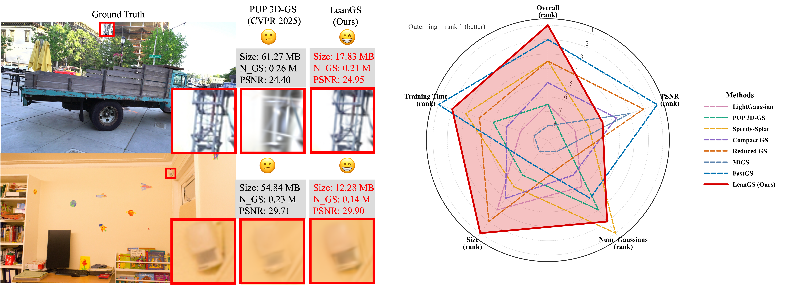
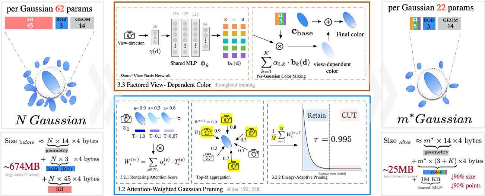

<div align="center">

# LeanGS
### Compact 3D Gaussian Splatting with Attention-Weighted Pruning and Factored View-Dependent Color

**ACM Multimedia 2026**

Mingda Xu · Xuanchen Lu · Boyu Cao · Xiaohan Zhang · Qi Liu  
South China University of Technology

[Paper](https://doi.org/10.1145/3767308.3835628) · [中文说明](README_zh-CN.md) · [Data preparation](docs/DATASETS.md) · [Experiment guide](docs/EXPERIMENTS.md)



</div>

LeanGS reduces storage for 3D Gaussian Splatting by removing redundant primitives and factoring view-dependent color into per-Gaussian coefficients and a shared learned basis.

The paper reports **24.88 MB** average model size across 13 scenes, a **96.3%** reduction relative to standard 3DGS, with a **0.06 dB** decrease in average PSNR.



## Installation

The environment targets Linux with an NVIDIA GPU, a CUDA toolkit with `nvcc`, and a compatible C++ compiler. The paper experiments used an RTX 4090. The source environment specifies Python 3.7.13, PyTorch 1.12.1 and CUDA runtime 11.6.

From the repository root:

```bash
conda env create --file environment.yml
conda activate fastgs
```

The environment name `fastgs` is inherited from the implementation's backbone. Required extension sources are included under `submodules/`; they are compiled locally during installation. If an extension needs to be rebuilt after installing PyTorch:

```bash
python -m pip install ./submodules/diff-gaussian-rasterization_fastgs
python -m pip install ./submodules/simple-knn
python -m pip install ./submodules/fused-ssim
```

## Data

Prepare the 13 scenes from Mip-NeRF 360, Tanks & Temples and Deep Blending as described in [Data preparation](docs/DATASETS.md). Datasets and trained models are stored separately from the source repository.

## Train one scene

Run the rank-5 bicycle configuration in the activated environment and replace the dataset path with your own:

```bash
CUDA_VISIBLE_DEVICES=0 python train.py \
  -s ./datasets/mipnerf360/bicycle \
  -m ./output/leangs/bicycle \
  -i images --eval --iterations 30000 \
  --densification_interval 500 --optimizer_type default \
  --test_iterations 30000 --save_iterations 30000 \
  --grad_abs_thresh 0.0012 \
  --use_lr_vdcf --lr_vdcf_k 5 --prune_top_k 4 --prune_ratio 0.25
```

## Render and evaluate

Pass the color-model options explicitly when rendering the trained rank-5 model:

```bash
CUDA_VISIBLE_DEVICES=0 python render.py \
  -m ./output/leangs/bicycle --iteration 30000 --skip_train \
  --use_lr_vdcf --lr_vdcf_k 5 --mult 0.5

CUDA_VISIBLE_DEVICES=0 python metrics.py -m ./output/leangs/bicycle
```

The model consists of the point-cloud file **and** its learned view-basis weights; keep both when moving a checkpoint. See [Experiment guide](docs/EXPERIMENTS.md) for output paths and scene-specific settings.

## Run all 13 scenes

Set the dataset locations, output directory and GPU, then run the training and evaluation launchers:

```bash
export NERF360_ROOT="$PWD/datasets/mipnerf360"
export TANDT_ROOT="$PWD/datasets/tanksandtemples"
export DB_ROOT="$PWD/datasets/deepblending"
export OUT_BASE="$PWD/output/leangs"
export CUDA_VISIBLE_DEVICES=0

bash scripts/train_all.sh
bash scripts/evaluate_all.sh
```

## Repository layout

```text
arguments/          Model and optimization options
gaussian_renderer/  Gaussian and factored-color rendering
scene/              Scene loading and Gaussian model implementations
utils/              Geometry, losses and learned view-basis utilities
submodules/         Bundled extension sources and their license notices
scripts/            Portable batch training and evaluation launchers
docs/               Data preparation and experiment instructions
train.py            Training entry point
render.py           Rendering entry point
metrics.py          Image quality evaluation
```

## Citation

```bibtex
@inproceedings{xu2026leangs,
  title     = {LeanGS: Compact 3D Gaussian Splatting with Attention-Weighted Pruning and Factored View-Dependent Color},
  author    = {Xu, Mingda and Lu, Xuanchen and Cao, Boyu and Zhang, Xiaohan and Liu, Qi},
  booktitle = {Proceedings of the 34th ACM International Conference on Multimedia},
  year      = {2026},
  doi       = {10.1145/3767308.3835628}
}
```

## Acknowledgments and licenses

This implementation builds on [FastGS](https://github.com/fastgs/FastGS) and the original [3D Gaussian Splatting](https://github.com/graphdeco-inria/gaussian-splatting) codebase. Third-party sources retain their original copyright and license notices. The repository contains material under multiple licenses; see [Third-party notices](THIRD_PARTY_NOTICES.md), [the inherited FastGS notice](LICENSE), [the original Gaussian Splatting license](LICENSE_ORIGINAL.md), and component-specific licenses under `submodules/`.
