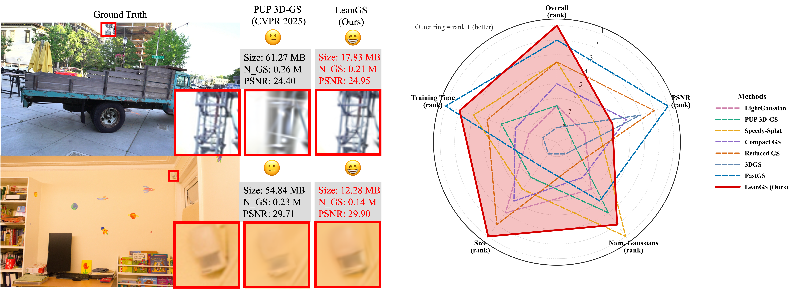

# LeanGS（论文配套代码）

论文中文释义：通过注意力加权删点与分解式视角相关颜色，实现紧凑三维高斯表示。

[论文正式入口](https://doi.org/10.1145/3767308.3835628) · [英文项目首页](README.md) · [数据准备说明](docs/DATASETS.md) · [实验运行说明](docs/EXPERIMENTS.md)



本项目在减少冗余高斯点的同时，用每个高斯点的少量系数与共享颜色基底网络表示视角相关颜色。论文报告了13个场景的结果；首页中的模型大小和画质数字均来自论文。

## 安装

需要带英伟达显卡的 Linux（操作系统）、CUDA（显卡计算开发工具）及兼容的编译器。原环境文件指定 Python（编程语言）3.7.13、PyTorch（深度学习框架）1.12.1、CUDA（显卡计算运行库）11.6。

在仓库根目录执行：

```bash
conda env create --file environment.yml
conda activate fastgs
```

`fastgs`（运行环境名称）对应本项目的安装配置。`submodules/`（底层扩展源码目录）内已包含依赖源码，安装时在本机重新编译。

## 数据与训练

先按[数据准备说明](docs/DATASETS.md)放好数据。下面以自行车场景的固定秩5配置为例：

```bash
CUDA_VISIBLE_DEVICES=0 python train.py \
  -s ./datasets/mipnerf360/bicycle \
  -m ./output/leangs/bicycle \
  -i images --eval --iterations 30000 \
  --densification_interval 500 --optimizer_type default \
  --test_iterations 30000 --save_iterations 30000 \
  --grad_abs_thresh 0.0012 \
  --use_lr_vdcf --lr_vdcf_k 5 --prune_top_k 4 --prune_ratio 0.25
```

`train.py`（训练入口）通过 `--use_lr_vdcf`（启用分解式视角相关颜色）选择颜色模型；`--lr_vdcf_k 5`（设置共享颜色基底数量为5）与 `--prune_top_k 4`（每点贡献统计使用前4个可见视角）对应不同参数；`--prune_ratio 0.25`（本入口使用的固定删点比例为四分之一）。

## 渲染与评测

```bash
CUDA_VISIBLE_DEVICES=0 python render.py \
  -m ./output/leangs/bicycle --iteration 30000 --skip_train \
  --use_lr_vdcf --lr_vdcf_k 5 --mult 0.5

CUDA_VISIBLE_DEVICES=0 python metrics.py -m ./output/leangs/bicycle
```

`render.py`（渲染入口）应显式传入与训练一致的颜色模型选项。`metrics.py`（图像质量评测入口）读取渲染结果与对应真实图像。搬运模型时需要同时保留点云文件及对应颜色基底网络权重。

完整13个场景可通过 `scripts/train_all.sh`（批量训练启动脚本）与 `scripts/evaluate_all.sh`（批量渲染评测启动脚本）运行；数据目录、输出目录与显卡选择方式见英文首页。各场景的具体超参数见实验运行说明。

## 引用与来源

论文引用格式见英文首页，`CITATION.cff`（机器可读的引用信息文件）也提供论文条目。代码基于 FastGS（快速三维高斯训练基准）和原始三维高斯实现。已有版权头和许可按原文保留，各组件的许可入口见[第三方来源说明](THIRD_PARTY_NOTICES.md)。
